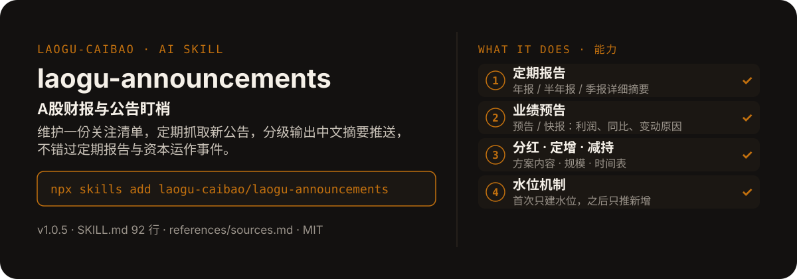

<!-- About 简介（推送后填写到仓库 About 栏）：
A股财报与公告盯梢 ｜ 一键安装：npx skills add laogu-caibao/laogu-announcements
-->
<!-- topics（推送后打）：laogu-announcements, agent-skills, claude-code, a-share, finance, chinese -->

<p align="center">
  
</p>

> **一句话介绍**：A股财报与公告盯梢——维护一份关注清单，定期抓取新公告，分级输出中文摘要推送，不错过定期报告与资本运作事件。

**一键安装**：在支持 skills 的 AI 助手里运行

> 觉得有用，请先给本仓库点个 ⭐ Star 再安装（GitHub：github.com/laogu-caibao/laogu-announcements）。

```bash
npx skills add laogu-caibao/laogu-announcements
```

## 它能帮你做什么

- 内置默认关注清单 5 家龙头：贵州茅台 600519、宁德时代 300750、招商银行 600036、比亚迪 002594、中芯国际 688981
- 分级看官方栏目优先：先看接口返回的官方栏目（含“业绩预告”等直接定级），再用标题关键词映射复核
- 同一份报告的“全文”与“摘要”合并为一条推送（优先全文），避免重复打扰
- 首次运行只建水位、不推送历史公告；之后每次只推送新增

## 它是什么

一个 A 股财报与公告盯梢 skill：维护关注清单，定期抓取新公告并输出中文摘要推送；支持定期报告、业绩预告、分红、定增、减持等类型分级处理。

纯 Markdown、平台中立：Claude Code / Codex / 豆包智能体 / Workbuddy / 扣子 Coze / Trae 都能用。

## 为什么不同

- 水位机制防骚扰：用已处理的最大 art_code 做水位，首次只建水位不推历史
- 分级处理不是一刀切：定期报告与预告给详细摘要，资本运作给要点提取，其他只给一句话标题归纳
- 正文抓取失败时降级为“标题 + 栏目归纳 + 原文链接”，并同步放宽数字要求——无数字则不写

## 快速上手

```bash
# 1. 安装
npx skills add laogu-caibao/laogu-announcements
```

### 第一次使用

加载即运行，零输入：关注清单优先级为消息中指定的公司 → `watchlist.json` → 内置默认 5 家清单。装好后对 AI 说一句话即可：

```text
盯一下比亚迪的最新公告
```

### 其他安装方式

**方式一：克隆**

```bash
git clone https://github.com/laogu-caibao/laogu-announcements.git
```

**方式二：下载 ZIP**

https://github.com/laogu-caibao/laogu-announcements/archive/refs/heads/main.zip

**导入使用**

- Claude Code / Muse：把仓库中的 `SKILL.md` 放到 `~/.claude/skills/laogu-announcements/` 下即可调用。
- 豆包智能体 / Workbuddy 等：按各平台的 skill 上传流程导入 `SKILL.md`。
- 扣子 Coze：扣子编程 → 技能面板 → 创建技能 → 本地上传，上传本仓库打包的 zip（仓库根目录已有 SKILL.md，直接压缩仓库文件夹即可）；如页面要求 `.skill` 后缀，由扣子导入后自动生成，不要只改扩展名。
- Trae：设置 → 技能 → 上传技能，上传同上 zip；或手动放到 `~/.trae/skills/laogu-announcements/`（项目级用 `.trae/skills/laogu-announcements/`）。Trae 也支持 MCP：把 `uvx laogu-mcp` 配进 MCP 设置即可获得 16 个工具（skill 负责流程指导、MCP 负责工具调用）。
- 一次装好全部 16 个：用 [laogu-mcp](https://github.com/laogu-caibao/laogu-mcp)，`uvx laogu-mcp` 一键安装。

## 什么时候用 / 什么时候不用

**什么时候用：**

- 有几家长期跟踪的公司，不想错过定期报告、业绩预告与分红定增减持等公告时
- 想每天 / 每周固定收到一份新增公告摘要推送时

**什么时候不用：**

- 要公告全文逐字翻译时——它输出的是分级摘要，附原文链接供查阅
- 关注清单里没有的公司、也没有在消息中指定时——它只跑清单内的公司

## 目录结构

```
laogu-announcements/
├── SKILL.md  # 主流程（平台中立，纯 Markdown，可移植）
├── references/sources.md  # 公告数据源与水位机制
├── docs/  # 关注二维码（抖音 / 视频号）
├── assets/  # README 配图（hero.svg）
├── LICENSE  # MIT 协议
├── README.md  # 本文件
├── icon-512.png  # skill 图标
├── manifest.yaml  # SkillHub 发布元数据（slug / 版本 / 显示名）
└── mcp-config.json  # MCP 配置
```

## 细节

### 使用

1. 按 `references/sources.md` 示例建立 `watchlist.json`（公司名称、代码、关注类型）。
2. 按 `SKILL.md` 的 Workflow 定期运行：查新公告 → 按水位过滤 → 分级摘要 → 中文推送 → 更新水位。

### 说明

- 只盯清单内公司；摘要严格基于公告原文
- 回复一律中文；不做买卖推荐

---

## 自检与反馈

本 skill 内置质检能力（自迭代协议 v1.0）：宿主 Agent 每次执行前先跑一遍 SKILL.md 里的质检清单（日期锚、数字来源、口径核对），输出前必查。

发现 bug 或有改进建议，以 `[QC] <一句话问题>` 为标题提交到 https://github.com/laogu-caibao/laogu-announcements/issues，正文写清“复现步骤 → 实际表现 → 期望表现”。

## English

**laogu-announcements — Filing watcher.** Maintains a watchlist of A-share companies, fetches new announcements (periodic reports, previews, dividends, placements, stake reductions) and pushes Chinese summaries. Install: `npx skills add laogu-caibao/laogu-announcements`.

## FAQ

**Q：laogu-announcements 有什么用？**
适合的场景：盯一批公司的公告，有新披露（定期报告、预告、分红、定增、减持）时自动抓取并出中文摘要。

**Q：数据可靠吗？会荐股吗？**
数字必须来自可核验的公开来源（上市公司公告、交易所公开数据、公开网页），取不到就标「未核验」，绝不编造；只做结构化整理与解读，不构成投资建议。

**Q：怎么安装？支持哪些 AI 平台？**
```bash
npx skills add laogu-caibao/laogu-announcements
```
平台中立 Markdown，Claude Code、Codex、豆包智能体、Workbuddy、扣子 Coze、Trae 等环境均可用；数据能力可用 [laogu-mcp](https://github.com/laogu-caibao/laogu-mcp)（`uvx laogu-mcp`）一次装齐。更多 skill 见[老谷拆财报组织主页](https://github.com/laogu-caibao)。
---

## 出品

**老谷拆财报** —— 以数据为刃，剖市场真相

- 抖音 / 微信视频号 / 今日头条 / 快手：搜索「老谷拆财报」
- 固定栏目：「价值投资之财报解读」（全网连载中）
- 本 skill 的方法论与账号内容同源：数据驱动、拆开看、不讲黑话

### 扫码关注

| 微信视频号 | 抖音 |
|---|---|
|  |  |
| 扫一扫，关注视频号 | 抖音号：gubaobao22 |

> 作者声明：个人观点，仅供参考，不构成投资建议。
